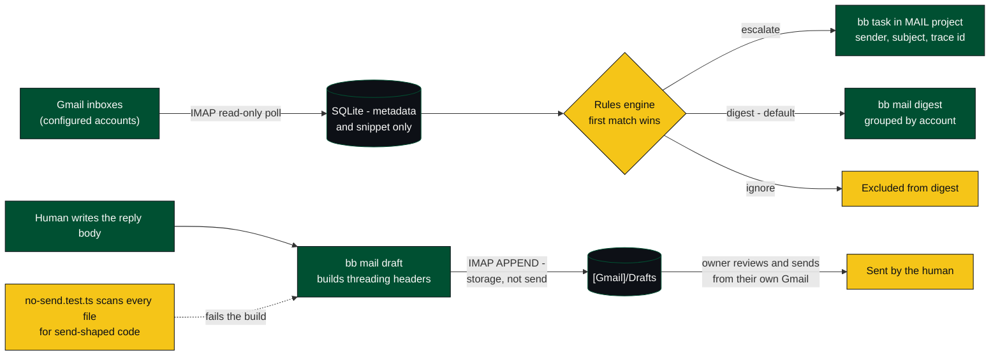

# bb-plugin-mail

An email agent over multiple Gmail accounts: it triages incoming mail
against rules, escalates what matters as internal bb tasks, and drafts
replies for a human to review.

## How it works



## Hard invariant: this plugin never sends email

There is no send/submit code path anywhere in this plugin — no SMTP client,
no `sendMail`, no Gmail API `messages.send`. Structurally:

- The poller (`lib/imap.ts` `pollInbox`) only reads INBOX over IMAP.
- Drafting (`bb mail draft`, `lib/imap.ts` `appendDraft`) only performs an
  IMAP `APPEND` into the account's own `[Gmail]/Drafts` folder — a storage
  operation, not a transmission. The draft is left for the account owner to
  review, edit, and send from their own Gmail client.
- Escalation (`lib/tasksCli.ts`) only creates a task in bb's Tasks plugin
  (project `MAIL`) — nothing leaves bb.
- `no-send.test.ts` scans every non-test source file for send-shaped code
  (`createTransport(`, `sendMail(`, `messages.send(`, a `nodemailer` import,
  raw SMTP socket connects) and for banned dependencies (`nodemailer`,
  `smtp-server`, `@sendgrid/mail`, `mailgun-js`/`mailgun.js`), and fails if
  any appear. It also asserts the CLI never registers a `send` command.

If a future change needs to send mail, that is a deliberate, separate
decision — not something this plugin should ever do quietly.

## Architecture

- **Settings** (`bb plugin config mail`): `accounts` is a JSON list of
  `{ address, secretName }` pairs; `pollIntervalMinutes` (default 5); up to
  five secret settings (`gmailAppPasswordPrimary` … `gmailAppPasswordQuinary`)
  hold each account's Gmail **app password** — never the account password
  itself, and never entered through chat. The plugin reports
  `needs-configuration` until at least one account is fully configured
  (present in `accounts` *and* has its named secret set).
- **Background service** (`poller`, `server.ts`): every `pollIntervalMinutes`,
  polls each configured account's INBOX via IMAP (`imapflow`), storing
  message metadata (sender, subject, a short snippet, receive time) in the
  plugin's own SQLite database — never full bodies for everything. Each new
  message is triaged against the rules table as it arrives.
- **Rules engine** (`lib/rules.ts`, table `rules`): a rule is
  `{ matchType: from | domain | subject-contains | list-id, matchValue,
  action: escalate | digest | ignore, urgency: low | normal | high }`.
  Rules are evaluated in creation order; the first match wins. No match
  falls back to `digest`/`normal` — unrecognized mail is surfaced, not
  dropped. Manage rules with `bb mail rule add|list|rm`.
- **Escalation** (`lib/tasksCli.ts`): an `escalate` match shells out to the
  `bb` CLI to create a task in the `MAIL` Tasks project (created on first
  use if missing), with sender/subject/snippet and the internal message id
  so a human can trace it back.
- **Drafting** (`bb mail draft <message-id> --body <text> | --body-file
  <path>`): builds a reply (`lib/mime.ts`, `Re:` subject, `In-Reply-To` /
  `References` threading headers) from the body the caller supplies — this
  plugin never generates reply content itself — and IMAP-`APPEND`s it into
  that account's `[Gmail]/Drafts` folder, so the draft shows up inside
  Gmail itself.
- **Digest** (`bb mail digest [--since <ISO date>]`, `lib/digest.ts`):
  prints unhandled/escalated mail grouped by account, newest first. Ignored
  mail is excluded. There is also a paused agent automation (project
  `proj_2net3x86vw`, daily 08:00 America/New_York) whose prompt reads the
  digest, triages against the rules, files escalation tasks, and drafts
  replies for anything that obviously needs one — citing this same
  never-send rule. It ships **paused**; someone has to unpause it.
- **Agent tool** `mail_inbox(query?, account?, limit?)`: lets agents read
  triage state without parsing CLI output.

## Install

```
bb plugin install .
```

Until at least one account is configured, `bb plugin list` will show
`mail` as `needs-configuration` — that is expected.

After editing sources, reload:

```
bb plugin reload mail
```

## Configure an account

1. Generate a Gmail **app password** for the account: Google Account →
   Security → 2-Step Verification (must be on) → App passwords → create one
   for "bb-plugin-mail".
2. Store it as a bb secret and set the account:

```
bb plugin config mail set accounts '[{"address":"you@gmail.com","secretName":"gmailAppPasswordPrimary"}]'
```

   (the app password itself is requested separately via `bb secret
   request`, never typed into chat — see the request already waiting in
   the UI for the first account).
3. Reload: `bb plugin reload mail`.

Add more accounts by extending the `accounts` JSON array and using the next
free secret slot (`gmailAppPasswordSecondary`, `...Tertiary`, `...Quaternary`,
`...Quinary`) — each one gets its own `bb secret request`.

## Types & API reference

`types/bb-plugin-sdk.d.ts` is the full, bundled BB plugin API —
`tsconfig.json` maps `@bb/plugin-sdk` to it. Clone
<https://github.com/ymichael/bb> to read the source when you need more detail.
